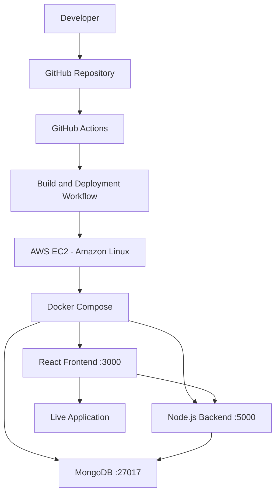

# 🚀 TaskFlow – MERN Stack with DevOps & CI/CD Automation

A containerized MERN application deployed on AWS EC2 with automated CI/CD using GitHub Actions.

## 🛠️ Technology Stack

- **Frontend:** React.js
- **Backend:** Node.js, Express.js
- **Database:** MongoDB
- **Containerization:** Docker
- **Orchestration:** Docker Compose
- **Version Control:** Git & GitHub
- **CI/CD:** GitHub Actions
- **Cloud Platform:** AWS EC2
- **Operating System:** Amazon Linux

## 📌 Project Overview

TaskFlow is a full-stack task management application built using the MERN stack.

The main objective of this project is to integrate application development with practical DevOps workflows.

The application is containerized using Docker and Docker Compose, while GitHub Actions automates the CI/CD process to deploy application updates directly to an AWS EC2 instance.

Whenever code changes are pushed to the configured GitHub branch, the automated workflow builds and deploys the latest application version without requiring manual deployment.

## ✨ Features

### Application Features
- Modern task management dashboard.
- Create and manage tasks.
- Track pending and completed tasks.
- Filter tasks by status.
- MongoDB-backed data persistence.
- Responsive user interface.

### DevOps Features
- Docker-based containerization.
- Multi-container orchestration using Docker Compose.
- Automated CI/CD using GitHub Actions.
- Automated deployment to AWS EC2.
- Linux server administration.
- Secure configuration using GitHub Secrets.
- Automated application updates after code pushes.

## 🏗️ Architecture

The project follows a containerized deployment architecture.



## ⚙️ Deployment Workflow

1. Developer makes application changes.
2. Changes are pushed to the GitHub repository.
3. GitHub Actions automatically triggers the configured workflow.
4. The pipeline executes build and deployment steps.
5. The deployment workflow connects to the AWS EC2 instance.
6. Docker Compose updates the running application containers.
7. The updated application becomes available to users.

## 📂 Project Structure

```text
devops-mern-todo/
│
├── .github/
│   └── workflows/
│       ├── ci.yml
│       └── cd.yml
│
├── backend/
│   ├── models/
│   ├── routes/
│   ├── tests/
│   ├── Dockerfile
│   ├── index.js
│   └── package.json
│
├── frontend/
│   ├── public/
│   ├── src/
│   └── package.json
│
├── docker-compose.yml
├── README.md
└── .gitignore
```

## 🚀 Getting Started

### Prerequisites

Install the following tools:

- [Node.js](https://nodejs.org/)
- [Docker Desktop](https://www.docker.com/products/docker-desktop/)
- [Git](https://git-scm.com/)
- GitHub Account

### 1. Clone the Repository

```bash
git clone https://github.com/Akshay-tech23/devops-mern-todo.git
cd devops-mern-todo
```

### 2. Install Dependencies

Backend:

```bash
cd backend
npm install
```

Frontend:

```bash
cd ../frontend
npm install
```

### 3. Configure Environment Variables

Create the required environment configuration files for the frontend and backend.

Configure the MongoDB connection string and other application settings according to the environment variables referenced in the application.

**Important:** Never commit environment files, database credentials, or AWS secrets to GitHub.

### 4. Run Using Docker Compose

From the project root directory:

```bash
docker compose up --build -d
```

Check running containers:

```bash
docker compose ps
```

View application logs:

```bash
docker compose logs -f
```

Stop the application:

```bash
docker compose down
```

### 5. Access the Application

| Component | Address |
|---|---|
| Frontend | http://localhost:3000 |
| Backend | http://localhost:5000 |
| MongoDB | Port 27017 |

## ☁️ AWS Deployment

TaskFlow is deployed on an AWS EC2 instance running Amazon Linux.

### Infrastructure Components

- AWS EC2 for application hosting.
- Amazon Linux for server administration.
- Docker for container management.
- Docker Compose for multi-container orchestration.
- GitHub Actions for automated deployment.

### Deployment Process

1. Push code changes to the configured GitHub branch.
2. GitHub Actions triggers the deployment workflow.
3. The workflow builds the required application images.
4. It connects to the EC2 server through SSH.
5. Docker Compose updates the application services.
6. Post-deployment checks validate the deployment.

## 🔄 CI/CD Pipeline

The project uses GitHub Actions for Continuous Integration and Continuous Deployment.

### Continuous Integration (CI)

- Triggered by configured repository events.
- Executes backend CI and test workflows.
- Uses MongoDB as a service for backend testing.

### Continuous Deployment (CD)

- Triggered by configured deployment events.
- Builds the latest Docker images.
- Connects to AWS EC2 through SSH.
- Deploys the updated application using Docker Compose.
- Performs post-deployment verification.

Sensitive deployment configuration is managed through GitHub repository secrets.

## 🔐 Security Considerations

- Store sensitive configuration in GitHub Secrets.
- Never expose AWS access credentials or private SSH keys.
- Keep environment files out of version control.
- Restrict EC2 security group access to required ports.
- Avoid exposing MongoDB publicly.
- Follow secure server administration practices.

## 🎯 Learning Outcomes

Through this project, I gained practical experience in:

- Building and managing a MERN stack application.
- Containerizing applications using Docker.
- Orchestrating services using Docker Compose.
- Creating CI/CD workflows using GitHub Actions.
- Deploying containerized applications on AWS EC2.
- Managing Linux servers through command-line tools.
- Automating application deployment.
- Understanding the complete Code-to-Cloud workflow.

## 🔮 Future Improvements

- [ ] Infrastructure as Code using Terraform.
- [ ] Application monitoring and observability.
- [ ] Centralized logging.
- [ ] Staging and production environments.
- [ ] Container image vulnerability scanning.
- [ ] Improved deployment health checks.
- [ ] Automated rollback strategy.

## 👨‍💻 Author

**Akshay A.**

B.Tech – Artificial Intelligence and Data Science

Aspiring Cloud & DevOps Engineer

- **GitHub:** [Akshay-tech23](https://github.com/Akshay-tech23)
- **LinkedIn:** [Akshay A.](https://www.linkedin.com/in/akshay-a-dev/)

---

<p align="center">
  Built with curiosity, automation, and continuous learning. 🚀
</p>

<p align="center">
  ⭐ If you find this project interesting, consider giving it a star!
</p>
